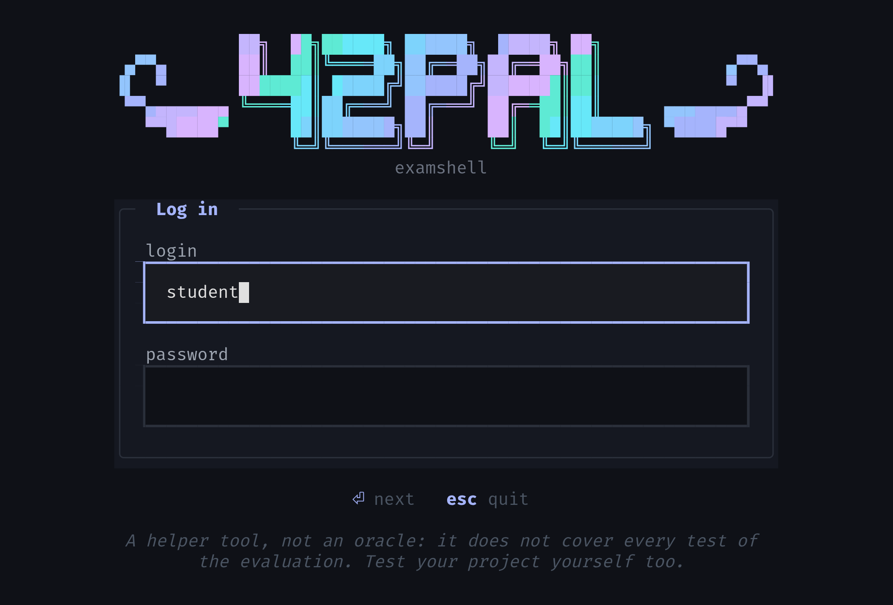
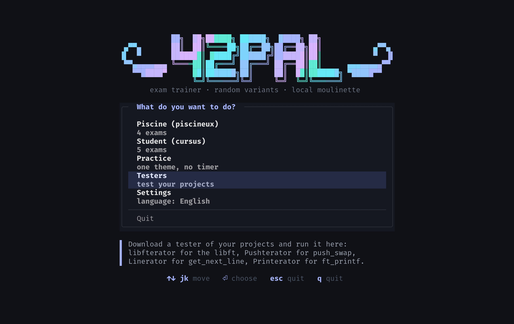
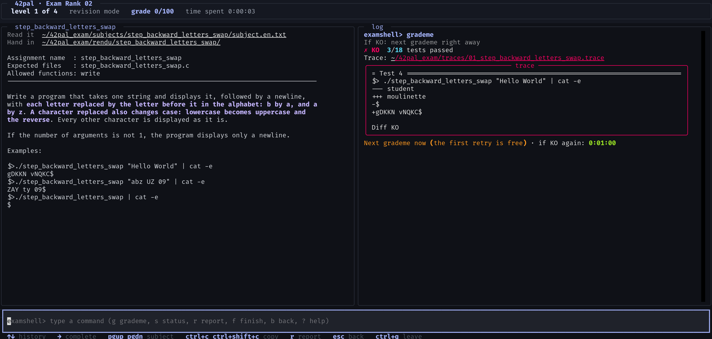
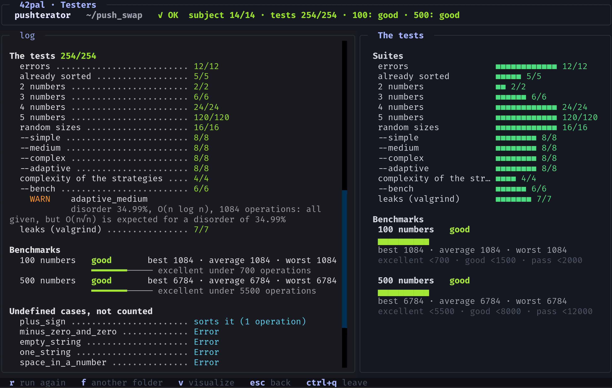
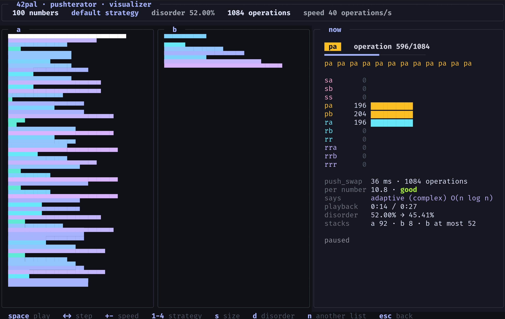

<p align="center">
  
</p>

# 42pal

[](https://github.com/Blaeste/42pal/actions/workflows/tests.yml)

An exam trainer for 42 students: it works like the examshell, but every
subject you get is a **variant** of an exercise, drawn at random, so you
train on the skill instead of learning one subject by heart. Your work is
graded on your machine, like the moulinette, with a trace when it fails.

It runs on the campus machines with **nothing to install and no sudo**.

## Install

You need Linux with:

- Python 3.10 or newer (the system `python3` is enough),
- a C compiler called `cc`, and `nm` (binutils),
- optionally `valgrind` (memory leaks) and `git` (to push your rendu).

```sh
git clone https://github.com/Blaeste/42pal.git
cd 42pal
./42pal
```

Or download the archive of the latest release (**Releases** on the page of
the repository), unpack it and run `./42pal` in its folder. It holds only
what runs 42pal: no tests, no reference solutions. Updates come through
git: with the archive, download the next release instead.

When a new version is pushed, `./42pal` says so after the login and offers
to update: yes runs `git pull`, then 42pal starts again on the new version.
It never asks for a password: with no network, or a remote that needs one,
it says nothing. `PAL42_NO_UPDATE=1 ./42pal` turns the check off.

No `pip`, no virtual environment: the libraries of the display,
[textual](https://github.com/Textualize/textual) and
[rich](https://github.com/Textualize/rich), are copied in `vendor/` (see
[vendor/README.md](vendor/README.md)).

## Take an exam

```sh
./42pal
```

<p align="center">
  
</p>

In a terminal, 42pal opens **full screen**: move in the menus with the arrow
keys (or `j` and `k`) and Enter, or with the mouse; `Esc` goes back to the
menu before. During the exam, the screen shows the level, the grade and the
time left (it runs live), the subject (`PgUp` and `PgDn` scroll it), a log of
your commands, and the `examshell>` line where you type them. The paths of
the subject, of your rendu and of the traces, and the web addresses, open with
a click: a file in its default application, a folder in the file manager, a
page in the browser (`xdg-open`, or `open` on macOS). To copy a prototype
or a header, select it with the mouse in the subject (or in the log; a
double-click takes the whole subject), then press Ctrl+C (or Ctrl+Shift+C,
in the terminals that do not keep it for themselves): it goes to the
clipboard (through the terminal, and `xclip`, `xsel` or `wl-copy` when there
is one). Ctrl+C with nothing selected, or Ctrl+Q, leaves. Shift+drag also
works: it is the terminal's own selection. `./42pal --plain` gives
the text interface, line by line; it is also used when the input is not a
terminal (answers sent through a pipe). There, the terminal opens the paths
with a Ctrl+click, if it knows links.

1. **Log in** like at the exam. The login defaults to your user name; the
   password can be anything, it is never checked nor kept.
2. **Choose what to do**: the exams of the piscine (piscineux), those of
   the students (cursus), or practice (see
   [Practise one theme](#practise-one-theme)). Then **choose the exam**
   among the ones for you: one of the 4 piscine exams, or one of the 5
   ranks for a student. Then choose the **mode** (see below). Exam mode starts at level 1,
   like the real exam; revision mode asks the **starting level**, among the
   levels that have exercises. Each menu says what its choices mean: the
   levels and length of each exam, the waits of each mode, the points of a
   level. Its last choice goes back to the menu before (Quit in the first
   one).
3. **Read the subject**: it is shown on the screen and written in
   `~/42pal_exam/subjects/<name>/subject.en.txt` (and in `subject.fr.txt`
   when 42pal speaks French, see [Settings](#settings-english-or-french)).
4. **Write your code** in `~/42pal_exam/rendu/<name>/`.
5. **Type `grademe`** at the `examshell>` prompt.

<p align="center">
  
</p>

```
~/42pal_exam/
├── subjects/<name>/subject.en.txt   the subject
├── rendu/<name>/                    your code
└── traces/                          a trace for each grademe
```

### Commands

| Command | Or | What it does |
|---|---|---|
| `grademe` | `g` | grades your work |
| `status` | `s` | exam, level, subject, time spent and left, next grademe |
| `report` | `r` | writes a report for an issue: the subject, your code, the last trace (see [Report a problem](#report-a-problem)) |
| `finish` | `f` | ends the exam, with a summary |
| `back` | `b` | back to the menus, after a wrong click in them (it asks first; Escape in full screen) |
| `help` | `?` | lists the commands |

`back` forgets an exam with no grademe yet; after a grademe, the exam goes to
your history as abandoned. In a practice, it loses nothing.

Type the command (or its letter), then Enter. The up and down arrows bring
back the commands you typed: up then Enter runs the last one again. The
right arrow (full screen) or Tab (text interface) completes a command. The grading runs while the screen stays
alive, with the number of the test being run.

### What grademe checks

In C, your files are compiled with `cc -Wall -Wextra -Werror`, then:

- the files the subject expects must be there;
- no forbidden function may be used (only those in "Allowed functions");
- each test must not crash nor run more than 5 seconds, and must print
  exactly what is expected;
- for some exercises, `valgrind` must find no leak.

In Python, the syntax of your file is checked first (`python3 -m
py_compile`), then:

- no module may be imported but those in "Allowed imports", and no call
  listed in "Forbidden" may be made (read in your code, comments and strings
  left out);
- each test calls your function (or the methods of your class) and must
  not raise nor run more than 5 seconds; what it returns must be exactly
  the expected value. The trace shows the call and both values:

```
= Test 2 =======================================================================
$> sort_by_digits(['a1', 'b22', 'c'])
--- student
+++ moulinette
-['a1', 'b22', 'c']$
+['b22', 'a1', 'c']$

Diff KO
```

**OK**: you go to the next level, with a new subject. **KO**: the trace is
shown in the terminal and written in `traces/` (the path can be clicked).
The student's lines are marked `-`, the expected ones `+`, shown like
`cat -e`:

```
= Test 1 =======================================================================
$> ./forward_shift_2 | cat -e
--- student
+++ moulinette
+$

Diff KO
```

### Two modes: exam and revision

After a KO, you keep the same subject, and the next grademe must wait a
little longer after each failure. The mode, chosen after the exam, sets
these waits and the time:

| Mode | Waits after the 1st, 2nd, 3rd... KO | Time |
|---|---|---|
| Exam | 0.5, 2.5, 3, 5.5, 8.5, 14, 22.5... min, like 42_EXAM | the real duration (Exam Rank 02: 3 h) |
| Revision (Enter) | 0, 1, 2, 3, 5 min: the first retry is free | no time limit |

Each grademe tells what a KO would cost, and `status` shows when the next
one is allowed. Each passed level is worth 100 divided by the number of
levels (25 points at rank 02), for a grade out of 100.

### Time, resume and history

- In exam mode, when the time is up, the exam ends (in full screen, at once;
  in the text interface, at the next command): a late grademe is not graded.
  You are warned once, 10 minutes before the end.
- Closed the terminal, or pressed Ctrl-C? Run `./42pal` again: it offers to
  resume your exam, with the same subject; the time kept running.
- Every finished exam is kept in `~/.42pal/history.json`, and every
  `grademe` (its subject, its theme, OK or KO) in `~/.42pal/grades.json`.
  Once there is one, the first menu offers **Progress**: how many exams you
  took, your best grades, and the themes that fail the most; pick one to
  practise it at once.
- `~/42pal_exam/rendu/` is also a git repository: `git add`, `git commit` and
  `git push` work like at the exam, but grademe grades your files whether
  they are committed or not.

## Practise one theme

Choose **Practice** in the first menu of `./42pal`, or go straight to it:

```sh
./42pal practice                       # a menu of the languages, then of the themes
./42pal practice --theme letter_rotation
```

Subjects of one theme, one after the other: no timer, no wait. The first
menu of practice chooses C or Python; Back in the theme menu returns to it
(and Back in the language menu returns to the first menu of 42pal).
A passed `grademe` (`g`) gives the next subject; `next` (`n`) skips to
another one; `finish` (`f`) stops. It opens full screen too, unless `--plain`
is given.

## Test your projects

Choose **Testers** in the first menu of `./42pal`, then a tester:

| Tester | Project | What it checks |
|---|---|---|
| [libfterator](https://github.com/Blaeste/Libfterator) | libft, subject v19.3 | the subject (files, Makefile, header, README, norm), the 43 functions, leaks, overflows, failed `malloc` |
| [Pushterator](https://github.com/Blaeste/Pushterator) | push_swap, subject of 2026 | the Makefile, the code, the README, errors, sorting, the four strategies and their complexity, `--bench`, the benchmarks of 100 and 500, the checker of the bonus, leaks |
| [Linerator](https://github.com/Blaeste/Linerator) | get_next_line | the subject (files, header, the build with and without `BUFFER_SIZE`, the functions allowed, README, norm), every `BUFFER_SIZE` from 1 to 10000000, the standard input, bad fds, failed `read` and `malloc`, reading little, the bonus, leaks |
| [Printerator](https://github.com/Blaeste/Printerator) | ft_printf, subject 12.1 | the subject (Makefile, `ar`, header, libft, functions allowed, README, norm), every conversion against printf, every flag of the bonus, random formats, failed `write` and `malloc`, leaks |

<p align="center">
  
</p>

The first time, 42pal asks before downloading the tester: it clones the
version 42pal is made for (a tag) into `~/.42pal/testers/` and checks its
commit. A newer 42pal can bring a newer version; it asks again before
updating. Nothing else uses the network.

Then choose the folder of your project. 42pal looks for it in your home
folder (the folders with a `libft.h` for libfterator, with a Makefile that
builds push_swap for Pushterator, with a `get_next_line.c` for Linerator,
with a Makefile that builds libftprintf.a for Printerator), the one tested
last first:

- in full screen, the list below the path shows them as they are found;
  type a path and the list follows it, with the folders in it (★ for a
  project, `..` to go up). ↑↓ move, Enter opens a folder or tests a
  project, Tab completes;
- in `--plain`, a small shell: the folders found by their number, `ls`,
  `cd`, `test` (or Enter alone), `help`, Tab completes.

The tester runs on a copy, never on your files. 42pal shows it at work,
live: the checks of the subject as they are done, a bar of the tests and
the failures as they come. Then the whole report, in the language of
42pal: each check of the subject, each function with its failing tests,
the undefined cases (not counted), the verdict and the full log. `r` runs
it again, `f` tests another folder. With Pushterator, Linerator and
Printerator, `v` opens their visualizer (of the sort, of the reads, the
comparator of ft_printf and printf; `Visualize` in `--plain`): 42pal steps
aside, and comes back when it is left.

<p align="center">
  
</p>

libfterator, Linerator and Printerator need Linux (or WSL), `cc` and `git`
(and `make` for libfterator and Printerator); Pushterator runs on macOS too.
Each one works on its own too, in its own clone: `./libfterator
/path/to/libft`, `./pushterator /path/to/push_swap`, `./linerator
/path/to/get_next_line`, `./printerator /path/to/ft_printf`.

## Settings: English or French

Choose **Settings** in the first menu: it lists the languages, each under
its own name (English, Français). The choice applies at once and is kept in
`~/.42pal/settings.json`; `PAL42_LANG=fr ./42pal` chooses it for one run.

In French, 42pal translates its menus and its messages, the traces of a
grademe (the titles, the verdicts, the crash messages; the commands and the
outputs stay as they are) and the subjects: the screen shows the French one,
written in `subject.fr.txt` next to `subject.en.txt`. Like the subjects of
42, the header of a subject stays in English, and so do the names of the
commands and the prompts `examshell>` and `practice>`. The testers give their
report in the language of 42pal too.

## What the catalog has today

Nine exams: the four piscine exams, and the five ranks of the cursus. A
student chooses one of the five ranks.

| Exam | Language | Levels | Time | Levels that can be played today |
|---|---|---|---|---|
| Exam Rank 02 | C | 4 (25 points each) | 3 h | 1, 2, 3, 4 |
| Exam Rank 03 | Python | 6 (16.67 points each) | 3 h | 1 to 6 |
| Exam Rank 04 | Python | 4 (25 points each) | 3 h | 1 to 4 |
| Exam Rank 05 | Python | 3 (33.33 points each) | 3 h | 1 to 3 |
| Exam Rank 06 | Python | 2 (50 points each) | 3 h | 1, 2 |
| Piscine Exam 01 | C | 8 (12.5 points each) | 4 h | 1 to 8 |
| Piscine Exam 02 | C | 8 (12.5 points each) | 4 h | 1 to 8 |
| Piscine Exam 03 | C | 4 (25 points each) | 4 h | 1 to 4 |
| Piscine Final Exam | C | 4 (25 points each) | 8 h | 1 to 4 |

In Python, the student hands in a `.py` file with the function the subject
asks for: a test main imports it, calls it and compares what it returns
with the expected value. The subject says which modules may be imported
(usually none) and which calls are forbidden (like `sorted()`). For a class,
the test main builds the object and calls its methods one after the other.

| Exercise | Kind | Theme | Variants |
|---|---|---|---|
| `shift_letters` | program | letter_rotation | 18 |
| `shift_words` | function | letter_rotation | 3 |
| `char_position` | function | string_length | 6 |
| `len_kinds` | function | string_length | 4 |
| `char_filter` | program | common_chars | 11 |
| `split_fields` | function, leaks checked | string_split | 7 |
| `print_range` | function (void, prints) | print_digits | 10 |
| `arg_pick` | program | pick_argument | 6 |
| `word_order` | program | word_reverse | 13 |
| `number_facts` | program | prime_factors | 9 |
| `base_string` | function, leaks checked | base_to_string | 6 |
| `byte_rotate` | function | bit_rotate | 12 |
| `sequence_array` | function, leaks checked | int_range | 10 |
| `list_drop` | function + header handed in, leaks checked | list_remove | 12 |
| `name_style` | program | case_convert | 18 |
| `word_pick` | program | find_word | 10 |
| `word_each` | program | find_word | 6 |
| `base_print` | program | print_in_base | 8 |
| `list_measure` | function, header given | list_walk | 10 |
| `number_read` | function | read_base_number | 11 |
| `tab_index` | function | array_search | 10 |
| `tab_sort` | function | array_sort | 8 |
| `nest_report` | program | bracket_check | 9 |
| `longest_span` | program | longest_part | 8 |
| `alpha_wave` | program | alternating_alphabet | 11 |
| `alpha_back` | program | backward_alphabet | 7 |
| `case_flip` | program | case_swap | 12 |
| `case_zone` | function | case_swap | 4 |
| `calc_form` | program | calculator | 11 |
| `replace_pick` | program | char_replace | 8 |
| `replace_count` | function | char_replace | 4 |
| `letter_step` | program | letter_step | 7 |
| `step_marks` | function | letter_step | 3 |
| `rev_part` | program | reverse_print | 5 |
| `back_print` | function (void, prints) | reverse_print | 3 |
| `repeat_rule` | program | letter_repeat | 5 |
| `repeat_alloc` | function, leaks checked | letter_repeat | 3 |
| `pointer_pair` | function | value_swap | 5 |
| `triple_swap` | function | value_swap | 4 |
| `copy_shape` | function | string_copy | 8 |
| `copy_part` | function | string_copy | 3 |
| `put_filter` | function (void, prints) | string_print | 8 |
| `put_shape` | function (void, prints) | string_print | 3 |
| `bip_bop` | program | number_words | 8 |
| `count_words` | program | number_words | 6 |
| `mirror_group` | program | alphabet_mirror | 7 |
| `word_from_end` | program | end_word | 8 |
| `merge_chars` | program | merged_chars | 8 |
| `sentence_case` | program | case_convert_back | 6 |
| `bit_check` | function | bit_test | 5 |
| `byte_show` | function (void, prints) | bit_print | 5 |
| `dup_shape` | function, leaks checked | string_dup | 5 |
| `compare_rule` | function | string_compare | 8 |
| `read_int` | function | read_number | 7 |
| `span_set` | function | char_span | 8 |
| `word_join` | program | space_cleanup | 8 |
| `word_spread` | program | space_spread | 6 |
| `caps_start` | program | capitalize_first | 6 |
| `caps_end` | program | capitalize_last | 6 |
| `prime_facts` | program | prime_sum | 6 |
| `divisor_facts` | program | common_divisor | 4 |
| `multiple_facts` | program | common_multiple | 4 |
| `arg_measure` | program | argument_count | 4 |
| `op_table` | program | number_table | 8 |
| `hop_range` | function, leaks checked | int_range_back | 6 |
| `hidden_trace` | program | hidden_order | 6 |
| `int_to_text` | function, leaks checked | number_to_string | 4 |
| `word_rotate` | program | word_rotate | 4 |
| `list_sort_by` | function, header given, leaks checked | list_sort | 8 |
| `zone_fill` | function | grid_fill | 5 |
| `letter_find` | program | letter_search | 6 |
| `set_first` | program | letter_or_fallback | 8 |
| `char_only` | program | one_char | 8 |
| `char_line` | program | one_char_end | 6 |
| `say_message` | program | fixed_message | 6 |
| `count_down` | program | digit_countdown | 6 |
| `param_from_end` | program | last_argument | 6 |
| `rev_inplace` | function | string_reverse | 4 |
| `bit_flip` | function | bit_reverse | 3 |
| `match_trace` | program | hidden_word | 6 |
| `list_loop` | function, header given | list_cycle | 3 |
| `list_each` | function, header given | list_apply | 4 |
| `set_run` | function | accept_span | 4 |
| `set_find` | function | set_search | 4 |
| `board_threat` | program | grid_attack | 8 |
| `tape_script` | program | tiny_interpreter | 6 |
| `byte_dump` | function | memory_dump | 4 |
| `flag_mask` | program | option_flags | 6 |
| `expr_eval` | program | postfix_calc | 3 |

The Python exercises of the ranks 03 to 06:

| Exercise | Kind | Theme | Variants |
|---|---|---|---|
| `nest_check` | function, rank 03 | bracket_balance | 6 |
| `key_sort` | function, rank 03 | multi_key_sort | 3 |
| `mirror_word` | function, rank 03 | palindrome_check | 3 |
| `grid_turn` | function, rank 03 | matrix_flip | 4 |
| `trace_letters` | function, rank 03 | subsequence_check | 3 |
| `char_mix` | function, rank 03 | shared_chars | 3 |
| `base_shift` | function, rank 03 | base_convert | 3 |
| `digit_steps` | function, rank 03 | digit_pairs | 4 |
| `letter_bag` | function, rank 03 | same_letters | 3 |
| `merge_twist` | function, rank 03 | sorted_merge | 3 |
| `char_balance` | function, rank 03 | char_multiset | 3 |
| `case_wave` | function, rank 03 | case_alternate | 3 |
| `shift_list` | function, rank 03 | list_rotate | 3 |
| `key_shift` | function, rank 03 | letter_shift | 3 |
| `turn_find` | function, rank 04 | rotation_check | 3 |
| `star_chart` | function, rank 04 | grid_plot | 3 |
| `common_sorted` | function, rank 04 | sorted_intersection | 3 |
| `merge_many` | function, rank 04 | k_way_merge | 3 |
| `mirror_parts` | function, rank 04 | palindrome_cuts | 3 |
| `need_order` | function, rank 04 | dependency_order | 3 |
| `window_stat` | function, rank 04 | window_max | 4 |
| `run_pack` | function, rank 05 | run_length | 3 |
| `path_fill` | function, rank 05 | spiral_fill | 3 |
| `slot_share` | function, rank 05 | interval_rooms | 3 |
| `loop_seek` | function, rank 05 | graph_cycle | 3 |
| `zone_count` | function, rank 05 | grid_regions | 4 |
| `grid_seek` | function, rank 05 | grid_word_search | 3 |
| `word_chain` | function, rank 05 | word_steps | 3 |
| `word_tree` | class, rank 06 | prefix_tree | 3 |
| `string_pack` | function, rank 06 | string_packing | 3 |
| `task_plan` | function, rank 06 | task_schedule | 3 |
| `edge_spare` | function, rank 06 | extra_edge | 3 |
| `word_complete` | function, rank 06 | prefix_complete | 3 |
| `set_groups` | class, rank 06 | disjoint_sets | 3 |
| `value_keeper` | class, rank 06 | lru_cache | 3 |
| `top_heap` | class, rank 06 | binary_heap | 3 |
| `cut_find` | function, rank 06 | graph_bridges | 2 |

The subjects are
written for 42pal: no real exam subject is in this repository. Each theme
of [themes.json](themes.json) is the style of one real exam subject, at the
levels where 42_EXAM places it, and a test checks it. A level draws one of
its styles, then one exercise of that style: like the real exam, which draws
one of the subjects of the level. The levels of the ranks follow the real
exams (57 subjects for the Exam Rank 02, then the Python ranks). All 77 C
styles and all 37 Python styles have an exercise.

## Report a problem

A crash, a grading that looks wrong, a subject that is unclear? Open an
issue on GitHub (**Issues**, then **New issue**: Bug or Subject), and paste
what this prints in it:

```sh
./42pal --report
```

It gives the version of 42pal, Python, the system, the tools and the exam
in progress: nothing personal, no code. The help of the examshell (`?`)
says it too.

For a problem with one subject, type `report` (or `r`) at the `examshell>`
(or `practice>`) prompt instead: it writes `~/42pal_exam/reports/<date>_<name>.md`
with the same lines, the subject, your code and the last trace, ready to
attach to the issue (in full screen, it is copied to the clipboard too). It
holds your code: share it only if you want to.

## For contributors

Clone the repository: the archives of the releases leave out the tests,
the plan and the reference solutions (see [.gitattributes](.gitattributes)).

Run the tests (Python's `unittest`, nothing to install):

```sh
python3 -m unittest
```

Check that the whole catalog grades right: each exercise has a reference
solution (`ref.c`, or `ref.py` in Python) that must pass every one of its
variants. When the
student hands in a header too, the reference header sits next to `ref.c`,
under its own name.

```sh
./42pal check-catalog
```

`./42pal check-catalog word_each set_find` checks only the exercises named.

GitHub runs the tests at each push to a branch (not for a tag), on Python
3.10 and 3.13, with clang as `cc` (see
[.github/workflows/tests.yml](.github/workflows/tests.yml)). It checks only
what changed, with what it can break
([tools/ci_scope.py](tools/ci_scope.py)): nothing for the docs alone, the
exercises changed when only exercises changed, and every exercise when the
core changed. The same choice works on a machine:
`PAL42_EXERCISES="word_each set_find" python3 -m unittest`.

| Folder | What is in it |
|---|---|
| `pal42/` | the core: exercises, variants, subjects, grading, the testers of projects (no display) |
| `pal42/cli/` | the terminal: examshell, practice, check-catalog, and the full screen (`tui.py`, `tui.tcss`) |
| `pal42/locales/` | the translations of the texts of 42pal, one file a language (`fr.json`) |
| `exercises/c/<name>/` | one exercise: `exercise.py`, its `ref.c` (and the header the student hands in, if any) |
| `exercises/python/<name>/` | one Python exercise: `exercise.py` and its `ref.py`, which holds the function of every variant |
| `exams/` | the exams: title, language, duration, compile command (the interpreter in Python), retry waits |
| `tests/` | the tests |

The texts of 42pal are written in English in the code and translated in
`pal42/locales/<code>.json`; a subject is translated in
`exercises/<language>/<name>/locales/<code>.json`. `python3 tools/locales.py
check` says what each language lacks, and `python3 tools/locales.py new
<code> "<Name>"` starts a new one.

The plan of the project, in French, is in
[docs/plans/42pal.md](docs/plans/42pal.md); the one of the testers in
[docs/plans/testers.md](docs/plans/testers.md), the one of the languages in
[docs/plans/languages.md](docs/plans/languages.md).

To try a tester before its tag is pushed, point 42pal at a local clone:
`PAL42_TESTER_LIBFTERATOR=/path/to/libfterator ./42pal`. The tag and its
commit are in [pal42/testers.py](pal42/testers.py).

## License

42pal has its own license, in [LICENSE](LICENSE): anyone may use it for
free and write new exercises for it, but its code may not be changed nor
reused elsewhere; copies are shared unchanged. The libraries in `vendor/`
keep their own licenses.
